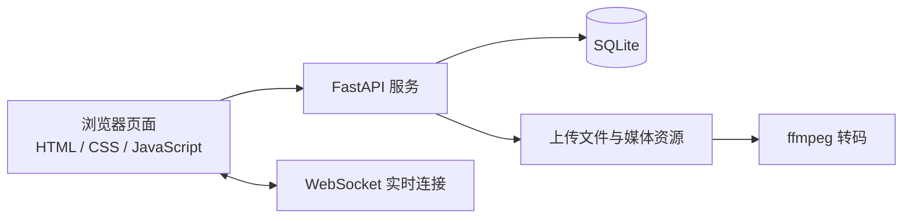

下面是可直接粘贴到 GitHub README 编辑页的版本。二维码使用你指定仓库里的原图链接；MIT 许可证文件目前尚未添加，所以 README 发布后还需要在仓库根目录新建 `LICENSE` 文件，并放入标准 MIT 许可证全文，才能让许可证链接有效。

```markdown
# QuickTalk V3 · Python 全栈即时通讯学习项目

> 一个基于 FastAPI、WebSocket、SQLite 和原生 HTML/CSS/JavaScript 的即时通讯实战项目。通过真实业务代码，学习实时通信、文件处理、数据库持久化与后台转码等常见 Web 开发技术。

[](https://www.python.org/)
[](https://fastapi.tiangolo.com/)
[](https://developer.mozilla.org/en-US/docs/Web/API/WebSockets_API)
[](LICENSE)

**QuickTalk V3** 是一个面向学习和二次开发的即时通讯项目。它使用 Python FastAPI 提供 Web 服务和 WebSocket 实时通信，以 SQLite 持久化数据，前端采用原生 HTML、CSS 和 JavaScript。

项目包含从登录、房间聊天、消息持久化到文件上传和媒体处理的实际业务流程，适合用来学习 Python Web 开发、WebSocket 实时交互和轻量级全栈应用的组织方式。

## 你能从这个项目中学到什么？

- **FastAPI Web 服务**：了解如何构建 Python Web 应用、处理请求并提供静态资源。
- **WebSocket 实时通信**：学习长连接如何支持聊天室消息和实时交互。
- **SQLite 数据持久化**：通过实际业务表和查询，理解用户、房间和消息等数据的存储方式。
- **文件上传与下载**：了解文件接收、保存、预览和下载等常见服务端流程。
- **媒体转码与后台处理**：学习如何调用 ffmpeg，并避免媒体处理任务阻塞正常聊天。
- **原生 JavaScript 前端**：在不依赖大型前端框架的情况下实现聊天界面、消息引用和主题切换等交互。
- **配置与权限管理**：了解邀请码注册、管理员权限和通过环境变量设置敏感配置的基本做法。
- **机器人客户端设计**：阅读独立的 `t-agent` 与 `dps-agent` 目录，了解机器人技能和客户端模块如何组织。

## 为什么适合学习？

- **容易启动**：使用 Python 和 SQLite，无需先搭建 MySQL 或 Redis 服务。
- **有完整业务流程**：可以沿着登录、加入房间、发送消息、上传文件等流程阅读代码。
- **代码可以直接运行和修改**：从项目入口、页面文件和工具模块逐步理解前后端如何配合。
- **适合动手扩展**：可以尝试替换数据库、添加测试、改进移动端体验或增加机器人技能。

> 本项目适合学习和本地体验。公开部署前请先修改默认管理员密码、检查服务器配置，并根据实际部署环境做好访问控制和数据备份。

## 快速开始

### 环境要求

- Python 3.10+（建议使用较新的 Python 版本）
- pip
- ffmpeg（媒体转码功能需要；未使用相关功能时可先不安装）

### 安装与启动

```bash
git clone https://github.com/feier3388992/chatroom-ttm.git
cd chatroom-ttm

# 可选：创建并启用虚拟环境
python -m venv .venv

# Windows PowerShell
.venv\Scripts\Activate.ps1

# macOS / Linux
# source .venv/bin/activate

pip install -r requirements.txt
python main.py
```

启动后访问：

```text
http://localhost:18675
```

首次启动会初始化运行所需的数据和邀请码。默认超级管理员账号为 `admin`，默认密码为 `admin`；首次使用时请尽快修改密码。服务支持通过环境变量 `QUICKTALK_SUPER_PASSWORD` 设置超级管理员密码。

更多安装和部署说明请参阅 [INSTALL.md](INSTALL.md)。

## 技术栈与架构

| 层级 | 技术 | 学习内容 |
| --- | --- | --- |
| Web 服务 | Python、FastAPI | Python Web 应用结构与请求处理 |
| 实时通信 | WebSocket | 长连接和实时消息交互 |
| 数据持久化 | SQLite | 轻量级关系型数据存储 |
| 前端 | HTML、CSS、原生 JavaScript | 页面结构、样式和浏览器交互 |
| 媒体处理 | ffmpeg | 调用外部媒体处理工具 |
| 配置 | YAML、环境变量 | 文件类型与敏感配置管理 |



## 项目结构

```text
chatroom-ttm/
├── main.py                 # FastAPI 服务入口与主要业务逻辑
├── utils/                  # 认证、文件配置等工具模块
├── pages/                  # 登录、聊天和管理页面
├── static/                 # CSS、JavaScript、字体和音效
├── t-agent/                # 独立聊天机器人及其技能
├── dps-agent/              # 机器人客户端工具
├── database/               # 运行时 SQLite 数据库
├── uploads/                # 运行时用户上传文件
├── wallpapers/             # 运行时聊天背景资源
├── transcodes/             # 运行时媒体转码缓存
├── file_types.yaml         # 文件类型配置
├── requirements.txt        # Python 依赖
├── requirements-full.txt   # 完整依赖清单
├── INSTALL.md              # 安装与部署说明
├── CHANGELOG.md            # 版本更新记录
└── README.md
```

数据库、邀请码、上传文件和转码缓存属于运行期数据，不应当作为公开源码中的个人数据或生产数据提交。

## 源码阅读建议

1. 从 `main.py` 开始，了解应用启动、路由和主要业务流程。
2. 搜索 WebSocket 连接与消息处理代码，跟踪消息如何到达客户端。
3. 阅读 `utils/auth_util.py`，了解认证、管理员账号和权限相关逻辑。
4. 阅读 `utils/file_config.py` 与 `file_types.yaml`，了解文件类型配置。
5. 阅读 `pages/` 和 `static/`，观察前端页面如何与服务端交互。
6. 最后阅读 `t-agent/` 和 `dps-agent/`，了解机器人技能和客户端代码。

## 二次开发练习建议

1. 为消息和房间相关逻辑补充 pytest 单元测试。
2. 尝试把 SQLite 替换为 PostgreSQL 或 MySQL。
3. 为多实例部署添加 Redis 消息转发或在线状态管理。
4. 改进移动端布局和键盘弹出时的聊天体验。
5. 为文件上传添加更细致的大小限制、格式校验和访问权限检查。
6. 在 `t-agent/skills/` 中添加新的机器人技能。
7. 编写 Dockerfile 和部署配置，练习容器化部署。

## 贡献与反馈

欢迎通过 GitHub Issues 反馈问题，也欢迎提交 Pull Request。

提交改动前，请尽量说明问题背景、修改内容和验证方式。

## 版权与许可证

本项目版权归 **梁飞鹏** 所有，项目采用 **MIT License**。

根据 MIT License 再分发本项目或其副本时，须保留版权声明和许可证文本。MIT License 不要求二次开发者必须展示额外的指定宣传语；如基于本项目进行二次开发，欢迎在项目介绍中注明来源：

> 本软件使用由梁飞鹏开发的 TTM 为基础的内核进行二次开发。

完整许可条款请见仓库根目录的 [LICENSE](LICENSE) 文件。

## 支持项目

如果这个项目对你的学习或开发有帮助，欢迎自愿支持作者：

- [通过爱发电支持作者](https://ifdian.net/u/35cbef06526911f1afb05254001e7c00)
- 微信扫码赞助：


扫码前请核对收款方信息。感谢每一份支持！

---

如果项目对你有帮助，欢迎点亮 ⭐ Star。
```

注意：我把你希望的 TTM 来源说明放进了 README，但明确标为“欢迎注明”，没有写成 MIT 强制要求。README 中的版本徽章没有写具体 FastAPI 版本，避免依赖版本升级后徽章过时。
